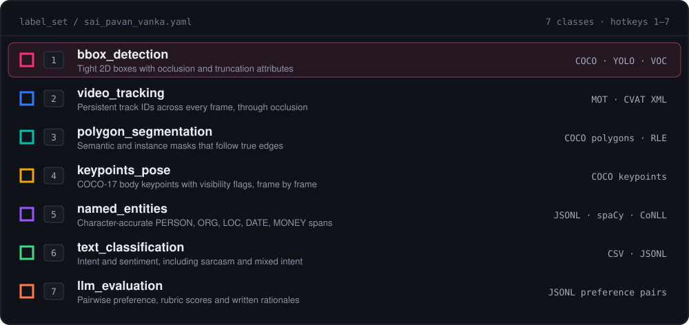
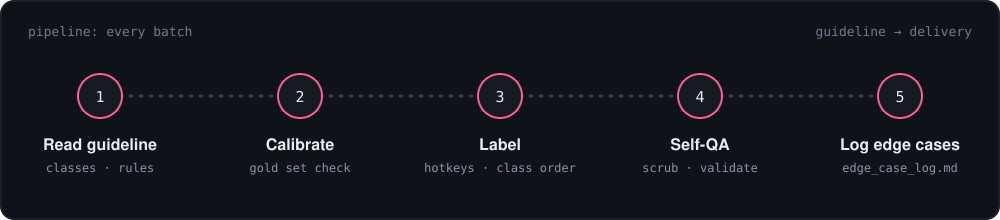
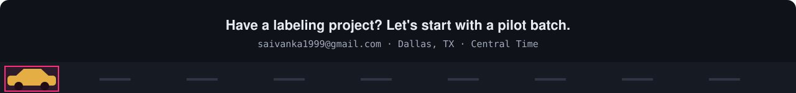

<!--
  Sai Pavan Vanka · GitHub profile README
  Setup: upload this README.md and the assets/ folder to the repo named exactly like your username.
  Then replace PORTFOLIO_LINK, LINKEDIN_LINK and YOUR-USERNAME.
-->

<p align="center">
  
</p>

<p align="center">
  <a href="PORTFOLIO_LINK"></a>
  <a href="https://github.com/YOUR-USERNAME/data-annotation-samples"></a>
  <a href="LINKEDIN_LINK"></a>
  <a href="mailto:saivanka1999@gmail.com"></a>
</p>

<br>

```json
{
  "id": 1,
  "class": "data_annotation_specialist",
  "name": "Sai Pavan Vanka",
  "location": "Dallas, TX",
  "attributes": {
    "data": ["images", "video", "text", "llm_outputs"],
    "focus": "labels a model can actually learn from",
    "works_in": ["your guideline", "your tool", "your export format"],
    "timezone": "US Central",
    "open_to": ["annotation projects", "QA review", "LLM evaluation"]
  },
  "occluded": false,
  "truncated": false
}
```

Hi, I'm **Sai**. I label image, video and text data for machine learning teams: tight boxes, stable track IDs, clean masks, and text labels that match what people mean. Every judgment call I make goes into an edge-case log, so your guideline gets better with each batch.

<br>

## `label_set` · what I annotate

<p align="center">
  
</p>

<br>

## `qa_review` · problems I solve

<p align="center">
  
</p>

<table>
  <tr>
    <th align="left">Problem</th>
    <th align="left">How I solve it</th>
    <th align="left">Result in my samples</th>
  </tr>
  <tr>
    <td>Loose boxes teach the model the wrong size</td>
    <td>Snap each side to the outermost visible pixel; check against a reference in QA</td>
    <td><b>IoU 0.56 → 0.97</b></td>
  </tr>
  <tr>
    <td>IDs swap when people cross paths</td>
    <td>Scrub every crossing; follow clothing and direction; one ID per object</td>
    <td><b>ID switches 2 → 0</b></td>
  </tr>
  <tr>
    <td>Building masks bleed into shadows</td>
    <td>Trace the roof edge using the sun direction, never the shadow line</td>
    <td><b>Mask 14,320 → 9,600 px²</b></td>
  </tr>
  <tr>
    <td>Sarcasm labeled as positive</td>
    <td>Label meaning, not keywords; write a reason for every ambiguous item</td>
    <td><b>Label matches intent</b></td>
  </tr>
</table>

<br>

## `pipeline` · how I work on every batch

<p align="center">
  
</p>

<br>

## `dataset` · featured work

<p align="center">
  
</p>

My **[data-annotation-samples](https://github.com/YOUR-USERNAME/data-annotation-samples)** repository holds the real export files behind my portfolio, plus the Python QA script that checks them before delivery.

```text
data-annotation-samples/
├── image/
│   ├── street_cam04_tracking/        300 frames · 7 tracks · MOT + YOLO
│   ├── aerial_tile_33_18_segmentation/   water · road · building · vegetation (COCO)
│   └── pose_jumping_jacks/           17 keypoints per frame (COCO)
├── text/
│   ├── ner/                          PERSON · ORG · LOC · DATE · MONEY spans
│   ├── classification/               intent + sentiment with annotator notes
│   └── llm_evaluation/               preference pair · 4-axis rubric · rationale
├── guidelines/                       labeling rules + edge-case log
└── scripts/validate_annotations.py   QA checks run before every delivery
```

<br>

## `tools` · what I work in

<p>
  
  
  
  
  
  
</p>
<p>
  
  
  
  
  
  
  
</p>

<br>

## `contact` · let's label something

Send me a small sample of your data and your guideline. I'll label a **pilot batch** and return it with an edge-case log, so you can judge the quality before you commit.

<p align="center">
  
</p>
